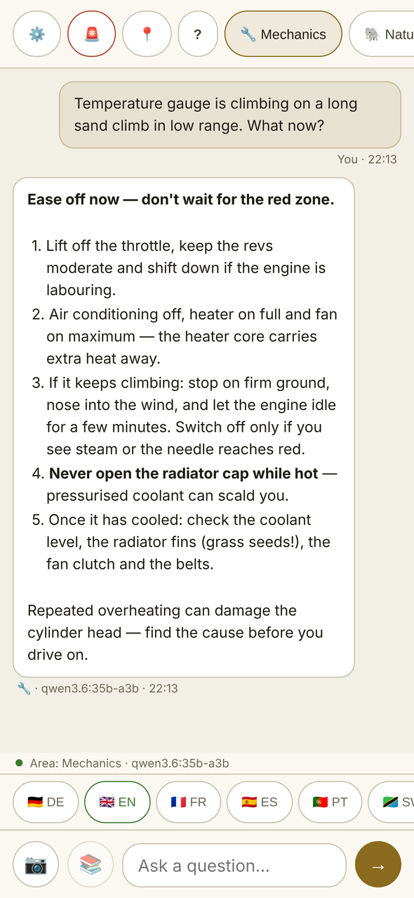
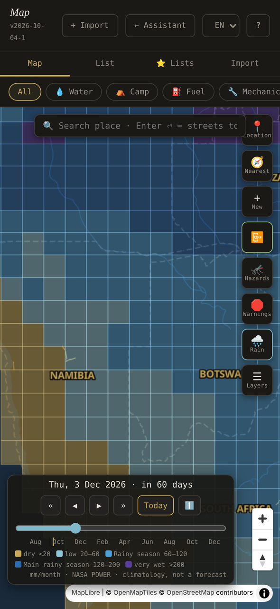
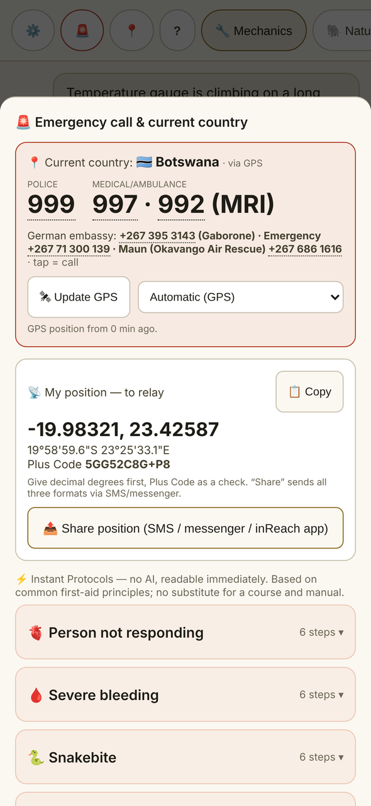

# Safari Assistant

<p align="center"><picture><source media="(prefers-color-scheme: dark)" srcset="docs/img/logo/safari-assistant-wordmark-dark.svg"></picture></p>

*Esta guía en: [English](README.md) · [Deutsch](README.de.md) · [Français](README.fr.md) · **Español***

**Un asistente de IA sin conexión para viajes por tierra (overland) por el sur y el este de África: módulos de chat con modelos locales en tu Mac, un mapa sin conexión con temporadas de lluvias y avisos de viaje oficiales, una ficha de emergencia que funciona sin IA y una vista para el móvil a través de tu propia Wi-Fi.**

Para Macs con Apple Silicon. En inglés, alemán, francés y español. Gratis para uso no comercial.

[](https://github.com/DarkPirateGo/safari-assistant/actions/workflows/ci.yml)
[](LICENSE)

> [!IMPORTANT]
> - **Solo Macs con Apple Silicon.**
> - **Qué Mac necesitas:** consulta [Qué modelo para cada Mac](#qué-modelo-para-cada-mac).
> - **Estado:** el autor lo usa en un viaje overland desde noviembre de 2026. Probado en un Mac (Apple Silicon, 36 GB) y un iPhone.

<p align="center">
<picture><source media="(prefers-color-scheme: dark)" srcset="docs/img/en/chat-dark.png"></picture>
<picture><source media="(prefers-color-scheme: dark)" srcset="docs/img/en/map-dark.png"></picture>
<picture><source media="(prefers-color-scheme: dark)" srcset="docs/img/en/emergency-dark.png"></picture>
</p>
<p align="center"><sub>Vista de ejemplo con datos de muestra ·
<a href="https://darkpiratego.github.io/safari-assistant/">Sitio web</a></sub></p>

---

## Qué hace

### 14 módulos de chat

Cada módulo tiene su propio prompt del sistema, su propio historial de chat y su propio modelo. 12 funcionan con modelos locales a través de [Ollama](https://ollama.com). 2 son módulos en línea opcionales que necesitan tu propia clave API de Anthropic.

| Módulo (nombre en la interfaz) | Temas | Modelo predeterminado |
|---|---|---|
| 🔧 Mecánica | Diagnóstico del vehículo y reparación sobre el terreno, adaptado al Toyota HZJ78 / diésel 1HZ | `qwen3.6:35b-a3b` |
| 🐘 Naturaleza y fauna | Fauna y plantas, identificación de especies, evaluación de peligros | `qwen3.6:35b-a3b` |
| 🏥 Medicina y primeros auxilios | Medicina tropical y de zonas remotas, primeros auxilios | `qwen3.6:35b-a3b` |
| 🗺️ Navegación y terreno | Rutas, terreno, vadeos, puestos fronterizos | `qwen3.6:35b-a3b` |
| 🐕 Perro | Salud y seguridad del perro durante el viaje | `qwen3.6:35b-a3b` |
| 🌿 Supervivencia y orientación | Agua, refugio, orientación, señales | `qwen3.6:35b-a3b` |
| 📸 Fotografía de fauna | Fotografía de fauna salvaje | `qwen3.6:35b-a3b` |
| 🗣️ Idiomas | Frases y traducción para la región | `qwen3.6:35b-a3b` |
| 🚨 Chat de emergencia | Chat de emergencia, instrucciones tranquilas paso a paso | `qwen3.6:35b-a3b` |
| 🌦️ Tiempo y temporadas de lluvias | Estaciones y periodos de lluvia. En el Mac se conecta a internet a través de Claude cuando hay una clave API guardada | `gemma4:e4b` |
| 🍳 Cocina de campamento | Cocinar con lo que hay en el vehículo | `gemma4:e4b` |
| 💪 Fitness | Entrenamiento sin material | `gemma4:e4b` |
| 🌍 Situación de seguridad — en directo | Situación de seguridad actual, con búsqueda web (en línea) | Claude, a elegir |
| ✦ Claude — IA en línea | Asistente general en línea con búsqueda web (en línea) | Claude, a elegir |

- Un solo ajuste cambia todos los módulos locales a otro modelo: ⚙️ Ajustes → IA y modelos → **Modelo global**.
- El modelo en línea se elige en ⚙️ Ajustes → IA y modelos → **Cargar lista**, que pregunta a Anthropic qué modelos puede usar tu clave; ahí también se ajusta el nivel de esfuerzo. Por defecto: `claude-sonnet-5-5`.
- **Tus propios manuales:** sube PDF, por ejemplo un manual de taller, un libro de primeros auxilios o una guía de viaje, y asígnalos a un módulo (requiere PyMuPDF, ver [Inicio rápido](#inicio-rápido)). El módulo busca en ellos sin conexión y cita el documento, el capítulo y la página.
- **Fotos:** adjunta una foto de una señal, una pieza, una planta o un animal y pregunta. Con los módulos locales, el modelo la analiza en tu Mac; no se sube nada.
- Los módulos también pueden buscar en una Wikipedia sin conexión opcional y citarla. Los artículos encontrados aparecen debajo de la respuesta y se abren con un toque en la Wikipedia sin conexión.
- **Perfil de viaje:** ⚙️ Ajustes → General → **Perfil de viaje**: quién viaja, vehículo, ruta y fechas, estilo de viaje, perro, con tus propias palabras (hasta 8.000 caracteres; **Insertar plantilla** da un esquema). Va con cada pregunta al modelo local, y a Claude solo si marcas **Enviar también a Claude (en línea)** (desactivado por defecto). Los datos de salud van en la ficha de emergencia, no aquí.
- **Situación de seguridad** busca con el país de tu posición GPS, mira primero los avisos de embajadas y los medios locales de los últimos 30 días y enumera debajo de la respuesta las fuentes que realmente citó.

### Mapa sin conexión

- Mapa vectorial a partir de tu propio `karte.mbtiles` (se genera una vez, consulta [docs/SETUP.md](docs/SETUP.md#6-offline-map), en inglés), o teselas en línea de OpenStreetMap.
- 🌧️ **Lluvia:** capa de temporadas de lluvias con una línea de tiempo día a día. Toca una celda para ver la lluvia mensual, las temperaturas, la humedad, el viento, la radiación solar y la temporada de malaria de ese mes. Muestra promedios a largo plazo, no una previsión.
- Panel ℹ️ del tiempo para tu posición; con conexión y a petición, una previsión de 7 días de Open-Meteo.
- 🛑 **Advertencias:** avisos de viaje oficiales de Alemania, el Reino Unido y Estados Unidos, descargados automáticamente cuando el Mac está en línea y legibles sin conexión. Los distritos con advertencia se dibujan como áreas, y Safari Assistant te indica si tu posición está dentro de una. Las áreas se actualizan solas cuando cambia un texto de advertencia, y el iPhone guarda una copia para cuando el Mac no está disponible.
- 🦟 **Peligros:** zonas de peligro (malaria, tsetsé, grandes animales, cocodrilos), además de los límites de los parques nacionales.
- **Unos 90 000 lugares** de OpenStreetMap vienen con la app, un archivo por país en `POIs/`, que se importa una vez en el mapa: campings, combustible, agua, talleres, hospitales, veterinarios y puestos fronterizos. También puedes importar tus propios archivos GPX, KML y GeoJSON.
- Búsqueda de lugares sin conexión; búsqueda de calles en línea solo cuando pulsas Intro.

### Ficha de emergencia (funciona sin IA)

- Números de emergencia por país (se pueden tocar para llamar) y números de las embajadas de Alemania.
- Tu posición en grados decimales, grados/minutos/segundos y Plus Code, para la radio o el mensajero satelital.
- 8 protocolos de primeros auxilios como texto fijo (**Protocolos inmediatos**), legibles con un solo toque.
- Campos personales (médicos, documentos, vehículo, contactos), tipo de cambio, horas de salida y puesta del sol, plazos de documentos.
- Un botón rojo **Emergencia** está arriba en la barra lateral (Ctrl+Mayús+N) y abre la ficha de emergencia.
- Si la IA local no responde, Medicina, Chat de emergencia, Perro y Supervivencia muestran en su lugar el protocolo inmediato correspondiente y los números de emergencia del país.

### Noticias por temas

- 📰 **Noticias:** noticias de feeds RSS, ordenadas en nueve temas — Seguridad, Fronteras y entrada, Combustible y suministros, Dinero y efectivo, Salud, Fenómenos naturales y tiempo, Carreteras y transbordadores, Parques y campings, Otras noticias. El país en el que estás aparece primero; **Solo importantes** muestra situaciones como fronteras cerradas, toques de queda o ciclones.
- Vienen 66 fuentes integradas: GDACS, CDC y UK FCDO, las alertas de seguridad de las embajadas de EE. UU. en los 16 países, un periódico por país (o AllAfrica) y una búsqueda por palabras clave en Google News. Cada una se puede desactivar, y puedes añadir tus propios feeds en **Fuentes**; **Comprobar** muestra antes lo que entregaría un feed.
- **📍 Cerca de ti:** las noticias de los últimos 14 días que mencionan un lugar a menos de 250 km de tu posición van primero, cada una con el lugar y la distancia. **🧭 Resumir la situación aquí** pide al modelo local que las resuma en cinco puntos como máximo, cada uno con el número de su noticia. Sin Claude, sin tokens.
- El Mac descarga los feeds cada 6 horas en cuanto está en línea; sin conexión, el último estado sigue legible, también en el iPhone.

### Herramientas de viaje

Listas de control, plazos de documentos, un plan de mantenimiento (plantilla para el Toyota HZJ78 / 1HZ, más tus propios puntos), un cuaderno de bitácora para combustible y mantenimiento, notas, respuestas guardadas, historial de chats y copias de seguridad.

- **Copia de seguridad automática en el Mac:** unos segundos después de cada cambio, los datos del navegador (cuaderno de bitácora, ficha de emergencia, plazos, notas, chats, ajustes) se copian en `~/.safari-assistant-sicherung/` (solo legible por ti), con una copia diaria durante una semana. Si la app se abre vacía (otro puerto, `127.0.0.1` en lugar de `localhost`, datos del sitio borrados), una banda ofrece restaurar. Los documentos subidos y los datos del iPhone no se incluyen; la clave de Claude, nunca. ⚙️ Ajustes → Datos y copia de seguridad.
- **Copias de seguridad con contraseña:** el archivo exportado puede cifrarse (AES-256-GCM, clave derivada con PBKDF2-SHA256 y 310 000 iteraciones, en el navegador). Una contraseña olvidada no se puede recuperar.

### Comprobación de VPN

- 🔒 Muestra claramente si el Mac está en línea **con o sin VPN**: verde, rojo («Sin VPN» o «Fuga de VPN» cuando IPv4 o IPv6 evitan el túnel), amarillo (configurar, dudoso, página de acceso Wi-Fi) o gris. Un recuadro arriba en la barra lateral, una banda roja sobre todas las vistas sin VPN y una barra en el iPhone.
- Se mide desde fuera, así que también funciona con una VPN en un router de viaje: con qué dirección pública aparece el Mac (IPv4 e IPv6 por separado) y a qué red pertenece. Guardas una vez la red de tu VPN; opcionalmente, Mullvad confirma sus propias salidas.
- Starlink cuenta como acceso, nunca como VPN. Entre dos comprobaciones una VPN puede caerse sin que se note; ayuda un kill switch en el router. ⚙️ Ajustes → Red y VPN.

### Vista móvil a través de tu propia Wi-Fi

`mobile.html` funciona en un iPhone conectado a la misma Wi-Fi: los mismos módulos, una hoja de emergencia 🚨, las noticias 📰 y el mapa, todo a través del Mac por HTTPS con un código de acceso. Consulta [Modo iPhone](#modo-iphone).

- Una cabecera sencilla: ⚙️ Ajustes · el área actual (tócala para cambiar de área y abrir las herramientas) · 🚨 Emergencia.
- **🆘 Enviar posición:** el primer botón de la hoja 🚨 obtiene una posición GPS reciente y la pone debajo de tu mensaje preparado (coordenadas, precisión, hora, enlace de mapa, Plus Code). Un toque más abre Mensajes (iMessage o SMS, el iPhone decide por contacto) o WhatsApp con todo rellenado; allí tocas **Enviar**. Destinatarios y texto se configuran una vez y se quedan en el iPhone. Con varios canales, un botón grande **📣 Enviar a todos** pasa por turnos por Mensajes (todos los destinatarios SMS a la vez) y luego por cada contacto de WhatsApp.
- **Sin el Mac:** una vez que el iPhone se ha conectado por HTTPS, la página también se abre cuando el Mac duerme, está cerrado o no comparte. Los protocolos inmediatos, los números de emergencia, tu posición y el SOS funcionan; las respuestas de la IA, no. Opcionalmente, una copia de tu ficha de emergencia se guarda en el iPhone (en el Mac ⚙️ Ajustes → Datos y copia de seguridad, desactivado por defecto). Si el Mac no responde, la página aparece en unos dos segundos.
- **Clave de Claude desde el Mac:** en el iPhone ⚙️ → **Obtener del Mac** muestra un código de cuatro cifras; el Mac muestra el dispositivo, su dirección y el mismo código, y allí lo permites. Opcionalmente, una clave aparte solo para el iPhone.
- **🛡 Ayuda local aquí:** guarda los números que te den por el camino (la seguridad del camping, una empresa de seguridad que recomienda alguien del lugar, un lodge) con el lugar y un radio. Cuando vuelvas a estar dentro de ese radio, aparecen en la hoja 🚨 con un botón de llamada. Los números sin prefijo de país se marcan como utilizables solo con una SIM del país. Se guardan solo en el iPhone y funcionan sin conexión.
- **🚓 Puestos y servicios cercanos:** policía, bomberos, puestos de guardas, empresas de seguridad, bases de ambulancias y de salvamento marítimo con número de teléfono en un radio de 100 km, de OpenStreetMap (incluidos, datos de noviembre de 2026; se actualizan con `python3 fetch-notfallkontakte.py`). El iPhone los guarda para usarlos sin conexión. Sin verificar, y en noviembre de 2026 menos del 4 % de las entradas tenía número.
- **🦏 Parques y guardas:** números de administraciones de parques y autoridades de fauna (por ejemplo Kruger, Montaña de la Mesa, Kenya Wildlife Service, Uganda Wildlife Authority), tomados de sus propias webs, cada uno con su fuente y la fecha de comprobación. Dentro de un parque, sus números van primero. Donde no se encontró ningún número oficial, la hoja lo dice.

### Opcional

- **Wikipedia sin conexión** mediante `kiwix-serve` (📚), también en el móvil.
- **Módulos en línea** con tu propia clave API de Anthropic.

Ámbito: 16 países — Angola, Botsuana, Burundi, Esuatini, Etiopía, Kenia, Lesoto, Malaui, Mozambique, Namibia, Ruanda, Sudáfrica, Tanzania, Uganda, Zambia, Zimbabue.

---

## Requisitos

| | |
|---|---|
| **Mac** | Apple Silicon, macOS |
| **Memoria** | Determina qué modelo puedes usar: consulta [Qué modelo para cada Mac](#qué-modelo-para-cada-mac). El modelo predeterminado `qwen3.6:35b-a3b` se midió en un Mac de 36 GB (unos 22 GB en uso). 32 GB probablemente no bastan para usarlo a plena velocidad de GPU (estimación) |
| **Ollama** | 0.34 o posterior (probado con 0.34.2), desde [ollama.com](https://ollama.com) o `brew install ollama` |
| **Python** | 3.9 o posterior. Iniciada desde el Finder, la app se ejecuta con `/usr/bin/python3` |
| **Node.js** | solo para el conjunto de pruebas |
| **Java 21+** | solo para generar el mapa sin conexión |
| **Opcional** | PyMuPDF (documentos PDF), kiwix-tools (Wikipedia sin conexión), una clave API de Anthropic (módulos en línea) |

| Descarga | Tamaño | Notas |
|---|---|---|
| Modelos | 6,6–33,5 GB, según tu Mac | Modelos predeterminados (`qwen3.6:35b-a3b` y `gemma4:e4b`): 29,6–33,5 GB, alrededor de 1,5 horas a 50 Mbit/s |
| Mapa sin conexión (`setup-offline-karte.sh`) | unos 8 GB al final, unos 80 GB de espacio libre durante la generación | tarda varias horas |
| Wikipedia sin conexión (archivos ZIM) | 2–55 GB, según el archivo | opcional |

Haz las descargas grandes en casa con una conexión rápida, mucho antes de salir. El índice de lugares, los límites de los parques, los datos climáticos y los POI vienen incluidos en este repositorio.

`server.py` es Python puro y puede funcionar en otros sistemas, pero solo se ha probado en macOS con Apple Silicon, y los scripts del paquete de la app son solo para macOS.

---

## Qué modelo para cada Mac

Toda la IA sin conexión se ejecuta en el Mac. El iPhone solo envía sus preguntas al Mac, así que la memoria unificada del Mac determina qué modelos puedes usar.

Comprobado el 4 de octubre de 2026. Los tamaños de descarga proceden de la biblioteca de Ollama. Son rangos, porque Ollama no indica si un Mac recibe la versión mlx o la llamacpp; planifica con la cifra mayor. Los valores **medidos** proceden de un solo Mac: MacBook Pro M5 Max, 36 GB, Ollama 0.34.2, contexto de 16.384 tokens. Todo lo demás es una **estimación** y no se ha probado con Safari Assistant.

| Memoria | Modelo de chat y de fotos | Descarga total (con `gemma4:e4b`) | Notas |
|---|---|---|---|
| 8 GB | `gemma4:e4b` (perfil ligero) | 6,6–9,5 GB | Estimación. Muy justo, puede ser lento. No recomendado para el viaje |
| 16 GB | `gemma4:e4b` (perfil ligero) | 6,6–9,5 GB | Estimación. Un único modelo pequeño para todo: respuestas menos detalladas (sin benchmark) |
| 24 GB | `gemma4:12b` | 14,6–17,2 GB | Estimación, mejora sin probar. La propia app sugiere aquí el perfil ligero |
| 32 GB | `gemma4:26b` | unos 25,5 GB | Estimación, sin probar. El modelo predeterminado probablemente no cabe entero en la GPU |
| 36–48 GB | `qwen3.6:35b-a3b` (predeterminado) | 29,6–33,5 GB | **Medido con 36 GB:** 22 GB en uso, 100 % GPU, unos 92–98 tokens/s. 48 GB: estimación |
| 64 GB o más | `qwen3.6:35b-a3b` (predeterminado) | 29,6–33,5 GB | Estimación: hay sitio para ambos modelos. Opcional: `qwen3.6:35b-a3b-q8_0` (39 GB) para mayor precisión |

Todos los Mac necesitan `gemma4:e4b`: el botón ⚡ **Rápido**, los resúmenes de chat sin conexión y los términos de búsqueda de Wikipedia lo usan siempre. Usa los nombres de etiqueta exactos: `gemma4:e4b`, no una variante como `gemma4:e4b-it-qat`.

Descarga los modelos una vez, con internet, en el Terminal:

```bash
# 8 GB y 16 GB
ollama pull gemma4:e4b

# 24 GB
ollama pull gemma4:12b
ollama pull gemma4:e4b

# 32 GB
ollama pull gemma4:26b
ollama pull gemma4:e4b

# 36 GB o más (predeterminados de la app, no hace falta ningún ajuste)
ollama pull qwen3.6:35b-a3b
ollama pull gemma4:e4b
```

Después, configura el modelo en Safari Assistant:

- **8 GB y 16 GB (perfil ligero):** haz clic en **Perfil ligero** en el banner de inicio, o pon ⚙️ Ajustes → **Modelo global** en `gemma4:e4b`.
- **24 GB y 32 GB:** pon ⚙️ Ajustes → **Modelo global** en `gemma4:12b` o `gemma4:26b`.
- **iPhone:** el móvil tiene su propio ajuste de modelo y no se sincroniza con el Mac. Configura el mismo modelo en ⚙️ Configuración → **Modelo de Ollama**.
- **8 GB, si `gemma4:e4b` es demasiado lento:** descarga `gemma4:e2b` (4,6–7,5 GB) y configúralo como modelo global en el Mac y en el iPhone. El botón ⚡, los resúmenes sin conexión y los términos de búsqueda de Wikipedia siguen usando `gemma4:e4b`.

> [!TIP]
> Después de hacer una pregunta en Safari Assistant, ejecuta `ollama ps`. La columna PROCESSOR debería mostrar `100% GPU`. Cualquier otra cosa, como `48%/52% CPU/GPU`, significa que el modelo no cabe en la GPU y las respuestas se vuelven mucho más lentas. En ese caso, elige un modelo más pequeño.

Conviene saber:

- macOS solo deja que la GPU use una parte de la memoria: unos 2/3 en los Mac más pequeños y unos 3/4 en los más grandes. Son mediciones de la comunidad; Apple no publica ninguna fórmula. Por eso 32 GB probablemente se quedan cortos para el modelo predeterminado (estimación).
- Con el perfil ligero, los módulos Medicina y primeros auxilios y Chat de emergencia también responden con el modelo pequeño. Las respuestas son más cortas y menos fiables. Comprueba todo lo que sea importante.
- Sin medir: si ambos modelos se mantienen cargados a la vez con 36 GB (si no, recargar `qwen3.6:35b-a3b` tardó unos 5–6 s), la velocidad en otros chips y la calidad de las respuestas y de las fotos con `gemma4:12b` y `gemma4:26b`. Las peticiones del iPhone pueden usar un contexto más largo (hasta 32.768 tokens), que necesita más memoria que la medida.

Fuentes: biblioteca de Ollama ([Qwen3.6](https://ollama.com/library/qwen3.6/tags), [Gemma 4](https://ollama.com/library/gemma4/tags)), [FAQ de Ollama](https://docs.ollama.com/faq), [Apple: recommendedMaxWorkingSetSize](https://developer.apple.com/documentation/metal/mtldevice/recommendedmaxworkingsetsize).

---

## Inicio rápido

**1. Instala Ollama** (0.34 o posterior) y asegúrate de que está en marcha. Después descarga los modelos. Para un Mac con 36 GB o más:

```bash
ollama pull qwen3.6:35b-a3b     # modelo predeterminado, para Macs con 36 GB o más
ollama pull gemma4:e4b          # modelo pequeño: ⚡ Rápido, resúmenes, módulos ligeros, términos de búsqueda de Wikipedia
```

Con menos memoria: descarga los modelos para tu Mac según [Qué modelo para cada Mac](#qué-modelo-para-cada-mac). No hace falta ninguna variable de entorno.

**2. Obtén Safari Assistant y genera la app:**

```bash
git clone https://github.com/DarkPirateGo/safari-assistant.git && cd safari-assistant
./deploy.sh        # comprueba las bibliotecas del mapa en vendor/ y ejecuta las pruebas si Node está instalado
./build-app.sh     # crea ~/Desktop/Safari Assistant.app
```

**3. Inicia Safari Assistant** con un doble clic en `Safari Assistant.app`. El lanzador inicia Ollama si aún no está en marcha, inicia el servidor y abre `http://localhost:8765` en tu navegador. Si el servidor no arranca, aparece un aviso «Safari Assistant startet nicht» (en alemán). Los registros están en `~/Library/Logs/Safari Assistant/`. Un clic en el icono del Dock trae al frente la pestaña de la app, y **Salir** en el Dock detiene el servidor; la primera vez, macOS pregunta si Safari Assistant puede controlar Safari. Para ello, `./deploy.sh` necesita las Xcode Command Line Tools; sin ellas, la app arranca como antes.

**Sin paquete de la app:** ejecuta `python3 server.py` en la carpeta del proyecto y abre `http://localhost:8765`. Ollama tiene que estar ya en marcha.

Qué hacen los dos scripts:

- `deploy.sh` descarga las bibliotecas del mapa en `vendor/` solo si faltan y comprueba sus hashes SHA-256 fijados. Ejecuta las pruebas si Node está instalado (puedes saltarlas con `DEPLOY_OHNE_TESTS=1`). Copia los archivos de la app en un `Safari Assistant.app` existente si lo encuentra, y avisa si no lo encuentra. Nunca hace commits en git, salvo que esté definido `DEPLOY_COMMIT=1` o exista un archivo marcador `.deploy-commit`; eso es solo para el mantenedor.
- `build-app.sh` crea `~/Desktop/Safari Assistant.app` con el servidor, los datos y las bibliotecas. Si lo vuelves a ejecutar, actualiza el paquete en su sitio. Tus datos dentro del paquete nunca se borran: documentos subidos, `rag-store.json`, `karte.mbtiles`, `fonts/` y `data/warnzonen.geojson`.

**Actualizar:** `git pull && ./deploy.sh` y después reinicia Safari Assistant.

**Puestos de emergencia (opcional):** los puestos de la hoja 🚨 del iPhone vienen con la app. Para actualizarlos desde OpenStreetMap: `python3 fetch-notfallkontakte.py` con internet (unos minutos) y después `./deploy.sh`.

**Documentos PDF (opcional):** instala PyMuPDF para el Python que ejecuta el servidor. Para la app iniciada desde el Finder, es `/usr/bin/python3 -m pip install --user pymupdf`. Reinicia Safari Assistant. Si una subida sigue fallando, el mensaje de error indica el intérprete exacto.

El mapa sin conexión, la Wikipedia sin conexión y todos los demás detalles: [docs/SETUP.md](docs/SETUP.md).

---

## Modo iPhone

1. En el Mac: ⚙️ Ajustes → **iPhone** → **App móvil**. La primera vez, los Ajustes te guían en cinco pasos; el código QR va al final:
   - **Crear certificado** (Mac): Safari Assistant crea una vez una autoridad de certificación (CA) local para este Mac.
   - **Descargar perfil** (Mac): el navegador guarda `Safari Assistant iPhone.mobileconfig` en Descargas; envíalo al iPhone con AirDrop.
   - **Instalar** (iPhone): Ajustes → **Perfil descargado** → Instalar. Después Ajustes → General → Información → **Ajustes de confianza de certificados** → activa **«Safari Assistant lokale CA»** (el certificado lleva este nombre en alemán; instalaciones antiguas: «DARK lokale CA» o «Safari Assistent lokale CA»). Este paso de confianza es el que la gente olvida.
2. **Mostrar código QR** (Mac) y escanéalo con la cámara del iPhone. El Mac escucha entonces también en su dirección Wi-Fi, en el mismo puerto 8765, y solo acepta HTTPS. Mientras se comparte, los Ajustes muestran lo que llega del iPhone: conectado, una conexión interrumpida (normalmente falta la confianza) o un código de acceso incorrecto.
3. Compartir → **Añadir a pantalla de inicio**. Cuando ya ha funcionado una vez, los Ajustes se abren directamente con **Mostrar código QR**.
4. **¿No funciona?** al final de los Ajustes enumera las causas habituales. Solo si el perfil no se puede instalar: el camino sin certificado (http, aviso de conexión no segura de Safari desactivado) — sin cifrar y sin GPS en el iPhone.

Conviene saber:

- El modo iPhone está siempre desactivado después de cada inicio. Se desactiva solo tras 12 horas sin peticiones del móvil y cuando Safari Assistant se cierra.
- Si el Mac no responde, la página del iPhone se abre igualmente con su contenido de emergencia en lugar de una página vacía (en cuanto se haya conectado una vez por HTTPS).
- **Nunca lo actives en una Wi-Fi en la que no confíes** (lodge, campamento, frontera). Usa tu propio router o el punto de acceso de un móvil.
- Subir, borrar, apagar y cambiar el modo solo funcionan en el propio Mac.
- La dirección contiene el nombre de red del Mac, y el certificado también. Dale antes al Mac un nombre neutro: Ajustes del Sistema → General → Compartir → Nombre de host local.
- La CA está limitada a nombres `.local` y direcciones privadas. Qué significa confiar en ella y cómo eliminarla: [SECURITY.md](SECURITY.md#the-local-certificate-authority).

---

## Qué sale a internet

Sin conexión, nada sale del Mac. Con conexión, esto es todo lo que envía Safari Assistant:

| Qué | Cuándo | Adónde, qué se envía | Cómo evitarlo |
|---|---|---|---|
| Avisos de viaje | A partir de 20 s después del inicio: siempre que la caché tenga más de 12 h; se reintenta cada 15 min | Auswärtiges Amt, UK FCDO, US State Department. Sin datos personales | Aún no hay interruptor ([hoja de ruta](docs/ROADMAP.md)) |
| Áreas de las zonas de advertencia | Tras una consulta de avisos, cuando ha cambiado un texto de advertencia o aún no existen áreas (como mucho cada 6 h) | Overpass API (OpenStreetMap). Sin datos personales | `SAFARI_OHNE_WARNZONEN_AUTO=1` |
| Noticias (RSS) | A partir de 60 s después del inicio: siempre que la última descarga tenga más de 6 h (`SAFARI_NACHRICHTEN_H`); se reintenta como mucho cada 30 min; además **Obtener ahora**, **Comprobar** y al añadir una fuente propia | Las fuentes activadas: gdacs.org, cdc.gov, gov.uk, la embajada de EE. UU. de cada país (`<país>.usembassy.gov`), un periódico por país o allafrica.com, news.google.com (nombre del país y palabras de búsqueda) y tus propios feeds. Sin datos personales | Desactivar fuentes (📰 Noticias → Fuentes) |
| Tipos de cambio | Cuando se abre la Ficha de emergencia (Mac) o la hoja 🚨 (móvil) | open.er-api.com. Sin posición | Aún no hay interruptor ([hoja de ruta](docs/ROADMAP.md)) |
| Teselas del mapa | Mientras el mapa muestra teselas en línea, lo predeterminado hasta que exista un `karte.mbtiles` sin conexión. Con un mapa sin conexión, se siguen cargando unas pocas teselas de vista general cada vez que se abre el mapa, antes de que cambie | tile.openstreetmap.org. Las teselas revelan la zona que estás mirando | Genera el mapa sin conexión |
| Glifos de las etiquetas del mapa | Solo si existe `karte.mbtiles` pero falta su carpeta `fonts/` | fonts.openmaptiles.org | `setup-offline-karte.sh` instala `fonts/` |
| Bibliotecas del mapa | Solo si faltan archivos en `vendor/` | unpkg.com (la página del mapa recurre a la CDN) | Mantén `vendor/` completo (`./deploy.sh`) |
| Búsqueda de lugares | Solo cuando pulsas Intro en la búsqueda del mapa | nominatim.openstreetmap.org. El texto de búsqueda | Si escribes sin pulsar Intro, solo se busca sin conexión |
| Panel del tiempo | Solo cuando haces clic en **Hoy** o **🌐 cargar** en el mapa | api.open-meteo.com. Posición redondeada a aproximadamente 1 km | No hagas clic |
| Comprobación de VPN | Mientras haya una página de Safari Assistant abierta (Mac o iPhone), más o menos una vez por minuto (de 30 s a 15 min, ajustable), y con **Comprobar ahora** | www.cloudflare.com (`/cdn-cgi/trace`), si no api.ipify.org / api6.ipify.org: tu dirección pública. stat.ripe.net: la red de esa dirección. captive.apple.com: detección de una página de acceso Wi-Fi. ipv4/ipv6.am.i.mullvad.net solo si la confirmación de Mullvad está activada. Sin posición, nada personal aparte de la dirección que ve cualquier web | ⚙️ Ajustes → Red y VPN → **Desactivar** |
| Anthropic | Con una clave API: cuando usas el módulo Claude o Situación de seguridad o el módulo Tiempo y temporadas de lluvias en el Mac, y con **Probar** / **Cargar lista** en los Ajustes. En el iPhone, Claude y Situación de seguridad llaman a Anthropic directamente desde el teléfono | api.anthropic.com. La clave, tu pregunta, una foto adjunta, el contexto del chat y, si está guardada, tu posición (±100 m); para la búsqueda web también el país de esa posición; tu perfil de viaje solo si marcaste **Enviar también a Claude (en línea)** | Borra la clave |
| Mensaje SOS | Solo cuando tocas un botón de envío en la hoja 🚨 y después **Enviar** en Mensajes o WhatsApp | Tus destinatarios, por Mensajes (iMessage/SMS) o WhatsApp: tu texto y tu posición | No enviar |
| Scripts puntuales | Solo cuando los ejecutas | `deploy.sh` → unpkg.com (solo los archivos de `vendor/` que falten; con `DEPLOY_LIZENZEN=1` también raw.githubusercontent.com para los textos de licencia originales). `fetch-*.py` → Overpass, GeoNames, NASA POWER; `fetch-notfallkontakte.py --amtlich` también saps.gov.za, police.gov.bw y police.gov.mw. `fauna-gbif-check.py` → GBIF. Generación del mapa → GitHub, Geofabrik y los archivos de océanos y de Natural Earth que descarga Planetiler | No los ejecutes |
| Ollama | Nunca para Safari Assistant | El lanzador inicia Ollama con `OLLAMA_NO_CLOUD=1` si no está en marcha. Un Ollama que hayas iniciado tú mantiene su propia configuración | – |

Sin telemetría, sin analítica, sin fuentes de Google.

---

## Seguridad y limitaciones

Safari Assistant da consejos sobre medicina, mordeduras de serpiente, reparación de vehículos, vadeos y emergencias. Las respuestas proceden de modelos de lenguaje que pueden equivocarse con total seguridad.

- **No** es un médico, un mecánico, un veterinario ni un guía. No sustituye la formación, un botiquín de primeros auxilios, un comunicador satelital ni el buen juicio.
- Contrasta todo lo que pueda hacerte daño con un manual impreso, la Wikipedia sin conexión o una persona. Safari Assistant no puede pedir ayuda; lleva un comunicador de emergencia de verdad.
- **Sin dosis de medicamentos**, a propósito. Los prompts indican al modelo que no dé ni invente dosis y que remita a un médico, a un veterinario o al prospecto.
- Los **números de emergencia** se comprobaron en septiembre de 2026. Verifícalos antes de salir.
- Los **puestos de OpenStreetMap** los introducen voluntarios, no están verificados y sus números a menudo no contestan: en un sondeo de junio de 2026 en Sudáfrica, más de la mitad de las comisarías llamadas no respondieron. Llama primero al número nacional. Los **números de los parques** se comprobaron en las webs de los propios operadores el 22 de noviembre de 2026; dos más antiguos están marcados como no confirmados. Los números gratuitos 0800 suelen funcionar solo con una SIM del país.
- Los **Protocolos inmediatos** en inglés, francés y español son traducciones del texto alemán, todavía sin revisar por profesionales de primeros auxilios.
- La **columna de embajadas recoge embajadas de Alemania**, para ciudadanos alemanes. Todos los demás deben recurrir a su propia embajada o consulado.
- Las **áreas de advertencia de viaje** son una lectura automatizada del texto oficial, no fronteras oficiales. Siempre prevalece el texto oficial; cada entrada enlaza con él.
- Las **noticias** se asignan a temas y países con una lista fija de palabras clave, no con IA: una noticia puede acabar en el tema equivocado, e **Importante** solo reconoce palabras conocidas. El título y el extracto vienen tal cual de la fuente; los periódicos y Google News no son fuentes oficiales. Lee el artículo y el aviso oficial de viaje antes de decidir.
- La **capa de lluvia** es una climatología 2001–2020 de NASA POWER, no una previsión. Las temporadas de lluvias se desplazan semanas de un año a otro.
- Con el **perfil ligero**, las respuestas médicas y de emergencia también proceden del modelo pequeño `gemma4:e4b`. Los Mac con menos de 36 GB no se han probado con Safari Assistant; consulta [Qué modelo para cada Mac](#qué-modelo-para-cada-mac).
- El **SOS** prepara un mensaje; no lo envía y no es un servicio de rescate. El SMS necesita cobertura móvil; iMessage y WhatsApp, internet. Enviar a varios destinatarios SMS a la vez usa un formato de enlace de iOS que Apple no documenta: pruébalo una vez con tu propio número.
- La **comprobación de VPN** muestra lo que midió, como mucho hace uno o dos minutos; una VPN puede caerse entre dos comprobaciones.
- Los prompts del sistema no están traducidos. Están escritos para un viajero de habla alemana: por ejemplo, los números de embajada son alemanes y el módulo Idiomas da la pronunciación para lectores alemanes. Aun así, las respuestas llegan en el idioma que elijas. El módulo Mecánica y el plan de mantenimiento están pensados para un único vehículo. Tus propios datos de viaje van en el **perfil de viaje**; un perfil estructurado (vehículo, nacionalidad para la columna de embajadas) está en la [hoja de ruta](docs/ROADMAP.md) (en inglés). Los tipos de cambio usan el EUR como moneda base.
- Los prompts del sistema piden al modelo que exprese su incertidumbre y que diga pronto cuándo hace falta ayuda profesional. Eso reduce el riesgo; no lo elimina.

---

## Idiomas

- **Interfaz:** inglés, alemán, francés y español. Hasta que elijas, Safari Assistant usa el idioma de tu navegador si es uno de estos cuatro; si no, inglés.
- **Cambiarlo:** en el Mac, con los botones **DE / EN / FR / ES** bajo el nombre de la app en la barra lateral, o en ⚙️ Ajustes → **Idioma de la interfaz**. En el iPhone: ⚙️ Configuración → **Idioma de la interfaz**. En la página del mapa: el menú de idioma de la cabecera. La elección se guarda.
- Las **respuestas de la IA** siguen el idioma de la interfaz. La fila 🌐 que hay sobre el cuadro de texto sigue fijando por separado el idioma de las respuestas: alemán, inglés, francés, español, portugués, suajili o afrikáans.
- **El alemán es el idioma de origen.** Una capa de traducción (`i18n.js` con `i18n/en.js`, `i18n/fr.js` e `i18n/es.js`) traduce la interfaz mientras se ejecuta. Lo que aún no está traducido se queda en alemán. Los prompts del sistema no se traducen; el idioma de las respuestas le indica al modelo qué idioma usar.
- Los 8 **Protocolos inmediatos** también están traducidos. La **Ficha de emergencia** tiene además su propia fila 🌐 (DE, EN, FR, PT, SW) para sus etiquetas y encabezados de tabla, para mostrársela a quien te ayude.
- Los archivos de Wikipedia sin conexión suelen estar en inglés. El modelo local pequeño convierte tu pregunta en términos de búsqueda en inglés.
- **Ayuda:** el **?** de cada página (barra lateral del Mac, barra de módulos y Configuración del iPhone, cabecera del mapa) abre esta guía en el idioma de la interfaz, sin conexión. El propio servidor de Safari Assistant la muestra en `/hilfe`. Si falta una traducción, aparece la guía en inglés.

Las traducciones son bienvenidas: [CONTRIBUTING.md](CONTRIBUTING.md#translations).

---

## Filtro de privacidad

El repositorio tiene un filtro de privacidad (`tools/privacy_gate.py`) para que nadie publique datos personales por accidente. Actívalo una vez después de clonar:

```bash
git config core.hooksPath .githooks
```

Se ejecuta en pre-commit, commit-msg y pre-push, y de nuevo en la CI. Bloquea exportaciones de tracks y waypoints (GPX, KML), copias de seguridad de la app, `rag-store.json`, documentos subidos, `*.mbtiles` y `*.zim`, claves y secretos, rutas y nombres de host personales, y metadatos de imágenes. Puedes añadir tus propios términos en una lista local fuera del repositorio.

Nunca lo eludas con `--no-verify`. Si marca algo inofensivo, dilo en el pull request. Detalles: [docs/PRIVACY-GATE.md](docs/PRIVACY-GATE.md).

---

## Desarrollo y pruebas

```bash
node test-app.js
```

Node puro, sin dependencias, sin paso de compilación. Las pruebas leen los archivos fuente como texto y comprueban que las correcciones y las funciones siguen ahí. También ejecutan las pruebas de Python (`test-reisewarnungen.py`, `test-tls.py`, `test-warngebiete.py`, `test-sicherheit.py`, `test-hilfe.py`), la autoprueba del filtro de privacidad (`tools/test_privacy_gate.py`) y el validador de datos de OSM (`tools/validate_osm_exports.py`). Estas necesitan `python3`, y `test-tls.py` necesita `openssl`; sin ellos, las pruebas se omiten con un aviso. La CI ejecuta el mismo conjunto en cada push y cada pull request.

Reglas, convenciones y la lista de comprobación para pull requests: [CONTRIBUTING.md](CONTRIBUTING.md). Cómo encajan las piezas: [docs/ARCHITECTURE.md](docs/ARCHITECTURE.md).

**Una nota sobre el nombre.** El nombre se escribe igual en todos los idiomas: Safari Assistant. Durante el desarrollo, la app se llamaba *Safari Assistent* (grafía alemana) y, poco antes de la primera publicación, brevemente *DARK*. DARK es ahora solo el nombre de su creador. Los identificadores internos no cambian, a propósito, para que las instalaciones existentes conserven sus datos, sus permisos de macOS y el certificado en el que confía el iPhone: las claves de almacenamiento del navegador `safari-*`, las bases de datos IndexedDB `safari-docs` y `safari-pois-db`, la cookie `safari_zugang`, los archivos `~/.safari-assistant-*`, las variables de entorno `SAFARI_*`, la carpeta del paquete `Contents/Resources/safari-assistant`, el bundle id `com.safari-assistent.app`, el archivo del certificado `~/.safari-assistant-tls/safari-assistent-ca.crt` y la firma del servidor `safari-assistent` (que devuelve `/api/ping`). Estos tres últimos mantienen la grafía del desarrollo, «assistent». De la breve etapa como DARK se conservan también a propósito: las variables globales de JavaScript `window.DARK_I18N` y `window.__DARK_I18N_DATEN` (cada diccionario de `i18n/` llama a esta última) y las variables de entorno `DARK_APP` y `DARK_LOG_DIR`.

---

## Licencias

- **Código:** [PolyForm Noncommercial License 1.0.0](LICENSE), © 2026 DARK (github.com/DarkPirateGo). Puedes usar, modificar y compartir Safari Assistant gratis para cualquier fin no comercial; es una licencia de código disponible (source-available), no una licencia de código abierto aprobada por la OSI. El uso comercial necesita una licencia aparte de DARK; pregunta en un [issue](https://github.com/DarkPirateGo/safari-assistant/issues). Qué permite la licencia: [NOTICE.md](NOTICE.md#safari-assistants-own-code).
- **No están bajo PolyForm Noncommercial:**
  - `POIs/*-osm.json` y `data/parks.geojson`: © colaboradores de OpenStreetMap, ODbL 1.0
  - `data/orte.json`: GeoNames, CC BY 4.0
  - `data/klima.json`: proyecto POWER del NASA Langley Research Center
  - `vendor/`: Leaflet (BSD-2-Clause), Leaflet.markercluster (MIT), MapLibre GL JS (BSD-3-Clause)
  - Codificador de códigos QR: adaptado de Project Nayuki, MIT
  - Los nombres «Safari Assistant» y «DARK», el logo y el icono de Safari Assistant (`docs/img/logo/`, `docs/img/social-preview.png`) y el logo de DARK `dark-logo.jpg`: todos los derechos reservados. Los forks deben sustituirlos como nombre y logo de su versión. La línea `Required Notice:` de [LICENSE](LICENSE), que nombra a DARK como titular de los derechos de autor, se mantiene: la licencia exige transmitirla.
- **No incluido, a propósito:** exportaciones de iOverlander, manuales de fabricantes, instantáneas de avisos de viaje.

Lista completa y textos de las licencias: [NOTICE.md](NOTICE.md).

---

## Créditos

Creado por DARK ([github.com/DarkPirateGo](https://github.com/DarkPirateGo)).

Construido sobre [Ollama](https://ollama.com), [Leaflet](https://leafletjs.com), [Leaflet.markercluster](https://github.com/Leaflet/Leaflet.markercluster), [MapLibre GL JS](https://maplibre.org), [Planetiler](https://github.com/onthegomap/planetiler), [OpenMapTiles](https://openmaptiles.org), [Kiwix](https://kiwix.org) y [PyMuPDF](https://pymupdf.readthedocs.io). Datos de los colaboradores de [OpenStreetMap](https://www.openstreetmap.org/copyright), de [GeoNames](https://www.geonames.org), de [NASA POWER](https://power.larc.nasa.gov) y de [Open-Meteo](https://open-meteo.com). Avisos de viaje del Ministerio Federal de Asuntos Exteriores de Alemania (Auswärtiges Amt), del FCDO del Reino Unido y del Departamento de Estado de EE. UU. Codificador de códigos QR adaptado de [Project Nayuki](https://www.nayuki.io/page/qr-code-generator-library).

<p align="center"><a href="https://github.com/DarkPirateGo"></a><br><sub>made by DARK</sub></p>
