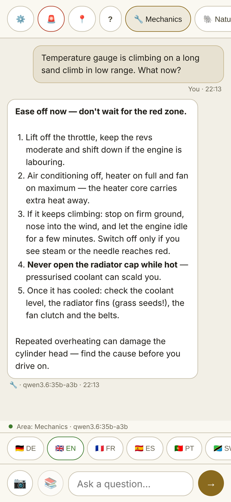
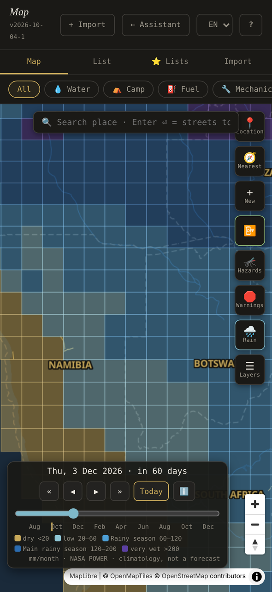
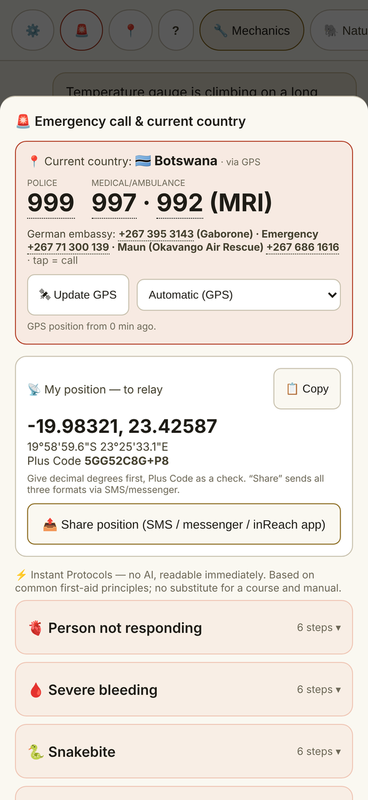

# Safari Assistant

<p align="center"><picture><source media="(prefers-color-scheme: dark)" srcset="docs/img/logo/safari-assistant-wordmark-dark.svg"></picture></p>

*This guide in: **English** · [Deutsch](README.de.md) · [Français](README.fr.md) · [Español](README.es.md)*

**An offline AI field assistant for overland travel in southern and eastern Africa: chat modules on local models on your Mac, an offline map with rain seasons and official travel warnings, an emergency card that works without AI, and a phone view over your own Wi-Fi.**

For Macs with Apple Silicon. In English, German, French and Spanish. Free for non-commercial use.

[](https://github.com/DarkPirateGo/safari-assistant/actions/workflows/ci.yml)
[](LICENSE)

> [!IMPORTANT]
> - **Apple Silicon Macs only.**
> - **Which Mac you need:** see [Which model on which Mac](#which-model-on-which-mac).
> - **Status:** used by the author for trip preparation. Not yet field-tested. Tested on one machine (Apple Silicon, 36 GB).

<p align="center">
<picture><source media="(prefers-color-scheme: dark)" srcset="docs/img/en/chat-dark.png"></picture>
<picture><source media="(prefers-color-scheme: dark)" srcset="docs/img/en/map-dark.png"></picture>
<picture><source media="(prefers-color-scheme: dark)" srcset="docs/img/en/emergency-dark.png"></picture>
</p>
<p align="center"><sub>Example view with sample data ·
<a href="https://darkpiratego.github.io/safari-assistant/">Website</a></sub></p>

---

## What it does

### 14 chat modules

Each module has its own system prompt, chat history and model. 12 run on local models through [Ollama](https://ollama.com). 2 are optional online modules that need your own Anthropic API key.

| Module (UI label) | Covers | Default model |
|---|---|---|
| 🔧 Mechanics | Vehicle diagnosis and field repair, tuned for the Toyota HZJ78 / 1HZ diesel | `qwen3.6:35b-a3b` |
| 🐘 Nature & Wildlife | Wildlife and plants, species identification, danger assessment | `qwen3.6:35b-a3b` |
| 🏥 Medicine & First Aid | Tropical and wilderness medicine, first aid | `qwen3.6:35b-a3b` |
| 🗺️ Navigation & Terrain | Routes, terrain, water crossings, border posts | `qwen3.6:35b-a3b` |
| 🐕 Dog | Dog health and safety on the road | `qwen3.6:35b-a3b` |
| 🌿 Survival & Orientation | Water, shelter, orientation, signalling | `qwen3.6:35b-a3b` |
| 📸 Wildlife Photography | Wildlife photography | `qwen3.6:35b-a3b` |
| 🗣️ Languages | Phrases and translation for the region | `qwen3.6:35b-a3b` |
| 🚨 Emergency Chat | Emergency chat, calm step-by-step guidance | `qwen3.6:35b-a3b` |
| 🌦️ Weather & Rainy Seasons | Seasons and rain periods. On the Mac it goes online via Claude when an API key is stored | `gemma4:e4b` |
| 🍳 Camp Kitchen | Cooking with what is in the vehicle | `gemma4:e4b` |
| 💪 Fitness | Training without equipment | `gemma4:e4b` |
| 🌍 Security Situation — Live | Current security situation, with web search (online) | Claude, selectable |
| ✦ Claude — Online AI | General online assistant with web search (online) | Claude, selectable |

- One setting switches every local module to another model: ⚙️ Settings → **Global Model**.
- The online model is chosen in ⚙️ Settings → Claude API → **Load list**, which asks Anthropic which models your key can use.
- **Your own manuals:** upload PDFs, such as a workshop manual, a first-aid book or a travel guide, and assign them to a module (needs PyMuPDF, see [Quick start](#quick-start)). The module searches them offline and cites document, chapter and page.
- **Photos:** attach a photo of a sign, a part, a plant or an animal and ask about it. With the local modules, the model looks at it on your Mac; nothing is uploaded.
- Modules can also search an optional offline Wikipedia and cite it.

### Offline map

- Vector map from your own `karte.mbtiles` (built once, see [docs/SETUP.md](docs/SETUP.md#6-offline-map)), or online OpenStreetMap tiles.
- 🌧️ **Rain:** rain-season layer with a day-by-day timeline. Tap a cell for monthly rain, temperatures, humidity, wind, solar radiation and the malaria season of that month. It shows long-term averages, not a forecast.
- ℹ️ weather panel for your position; when online and on request, a 7-day forecast from Open-Meteo.
- 🛑 **Warnings:** official travel warnings from Germany, the UK and the US, fetched automatically whenever the Mac is online and readable offline. Warned districts are drawn as areas, and Safari Assistant tells you whether your position is inside one.
- 🦟 **Hazards:** hazard zones (malaria, tsetse, big game, crocodiles), plus national park boundaries.
- **About 90,000 places** from OpenStreetMap ship with the app, one file per country in `POIs/`, imported once on the map: campsites, fuel, water, workshops, hospitals, vets and border posts. Your own GPX, KML and GeoJSON files can be imported too.
- Offline place search; online street search only when you press Enter.

### Emergency Card (works without AI)

- Emergency numbers per country (tappable) and German embassy numbers.
- Your position as decimal degrees, degrees/minutes/seconds and Plus Code, for radio or satellite messenger.
- 8 first-aid protocols as fixed text (**Instant Protocols**), readable in one tap.
- Personal fields (medical, documents, vehicle, contacts), exchange rate, sun times, document deadlines.

### Trip tools

Checklists, document deadlines, a maintenance plan (template for the Toyota HZJ78 / 1HZ, plus your own items), a logbook for fuel and maintenance, notes, saved answers, chat history and backups.

### Phone view over your own Wi-Fi

`mobile.html` runs on an iPhone in the same Wi-Fi: the same modules, a 🚨 emergency sheet and the map, all through the Mac over HTTPS with an access code. See [iPhone mode](#iphone-mode).

### Optional

- **Offline Wikipedia** via `kiwix-serve` (📚), also on the phone.
- **Online modules** with your own Anthropic API key.

Scope: 16 countries — Angola, Botswana, Burundi, Eswatini, Ethiopia, Kenya, Lesotho, Malawi, Mozambique, Namibia, Rwanda, South Africa, Tanzania, Uganda, Zambia, Zimbabwe.

---

## Requirements

| | |
|---|---|
| **Mac** | Apple Silicon, macOS |
| **Memory** | Decides which model you can use: see [Which model on which Mac](#which-model-on-which-mac). The default model `qwen3.6:35b-a3b` was measured on a 36 GB Mac (about 22 GB in use). 32 GB is probably not enough for it at full GPU speed (estimate) |
| **Ollama** | 0.34 or newer (tested with 0.34.2), from [ollama.com](https://ollama.com) or `brew install ollama` |
| **Python** | 3.9 or newer. Started from Finder, the app runs with `/usr/bin/python3` |
| **Node.js** | only for the test suite |
| **Java 21+** | only to build the offline map |
| **Optional** | PyMuPDF (PDF documents), kiwix-tools (offline Wikipedia), an Anthropic API key (online modules) |

| Download | Size | Notes |
|---|---|---|
| Models | 6.6–33.5 GB, depending on your Mac | Default models (`qwen3.6:35b-a3b` and `gemma4:e4b`): 29.6–33.5 GB, about 1.5 hours at 50 Mbit/s |
| Offline map (`setup-offline-karte.sh`) | about 8 GB final, about 80 GB free space while building | runs for several hours |
| Offline Wikipedia (ZIM files) | 2–55 GB, depending on the archive | optional |

Do the large downloads at home on a fast connection, well before you leave. The place index, park boundaries, climate data and POIs ship in this repository.

`server.py` is plain Python and may run elsewhere, but only Apple Silicon macOS is tested, and the app bundle scripts are macOS-only.

---

## Which model on which Mac

All offline AI runs on the Mac. The iPhone only sends its questions to the Mac, so the Mac's unified memory decides which models you can use.

Checked on 4 October 2026. Download sizes come from the Ollama library. They are ranges, because Ollama does not say whether a Mac gets the mlx or the llamacpp build; plan with the larger number. **Measured** values come from one Mac: MacBook Pro M5 Max, 36 GB, Ollama 0.34.2, context 16,384 tokens. Everything else is an **estimate** and is not tested with Safari Assistant.

| Memory | Chat and photo model | Total download (with `gemma4:e4b`) | Notes |
|---|---|---|---|
| 8 GB | `gemma4:e4b` (light profile) | 6.6–9.5 GB | Estimate. Very tight, may be slow. Not recommended for the trip |
| 16 GB | `gemma4:e4b` (light profile) | 6.6–9.5 GB | Estimate. One small model for everything: less detailed answers (not benchmarked) |
| 24 GB | `gemma4:12b` | 14.6–17.2 GB | Estimate, untested upgrade. The app itself suggests the light profile here |
| 32 GB | `gemma4:26b` | about 25.5 GB | Estimate, untested. The default model probably does not fit fully on the GPU |
| 36–48 GB | `qwen3.6:35b-a3b` (default) | 29.6–33.5 GB | **Measured on 36 GB:** 22 GB in use, 100 % GPU, about 92–98 tokens/s. 48 GB: estimate |
| 64 GB or more | `qwen3.6:35b-a3b` (default) | 29.6–33.5 GB | Estimate: room for both models. Optional: `qwen3.6:35b-a3b-q8_0` (39 GB) for higher precision |

Every Mac needs `gemma4:e4b`: the ⚡ **Fast** button, offline chat summaries and the Wikipedia search terms always use it. Use the exact tag names: `gemma4:e4b`, not a variant like `gemma4:e4b-it-qat`.

Pull the models once, with internet, in Terminal:

```bash
# 8 GB and 16 GB
ollama pull gemma4:e4b

# 24 GB
ollama pull gemma4:12b
ollama pull gemma4:e4b

# 32 GB
ollama pull gemma4:26b
ollama pull gemma4:e4b

# 36 GB or more (app defaults, no settings needed)
ollama pull qwen3.6:35b-a3b
ollama pull gemma4:e4b
```

Then set the model in Safari Assistant:

- **8 GB and 16 GB (light profile):** click **Light profile** in the start banner, or set ⚙️ Settings → **Global Model** to `gemma4:e4b`.
- **24 GB and 32 GB:** set ⚙️ Settings → **Global Model** to `gemma4:12b` or `gemma4:26b`.
- **iPhone:** the phone has its own model setting and is not synced with the Mac. Set the same model in ⚙️ Setup → **Ollama model**.
- **8 GB, if `gemma4:e4b` is too slow:** pull `gemma4:e2b` (4.6–7.5 GB) and set it as the global model on the Mac and the iPhone. The ⚡ button, offline summaries and Wikipedia search terms still use `gemma4:e4b`.

> [!TIP]
> After a question in Safari Assistant, run `ollama ps`. The PROCESSOR column should show `100% GPU`. Anything else, such as `48%/52% CPU/GPU`, means the model does not fit on the GPU, and answers become much slower. Then choose a smaller model.

Good to know:

- macOS lets the GPU use only part of the memory: about 2/3 on smaller Macs and about 3/4 on larger ones. These are community measurements; Apple publishes no formula. That is why 32 GB is probably too little for the default model (estimate).
- With the light profile, the Medicine & First Aid and Emergency Chat modules also answer from the small model. Answers are shorter and less reliable. Check anything that matters.
- Not measured: whether both models stay loaded together on 36 GB (if not, reloading `qwen3.6:35b-a3b` took about 5–6 s), the speed on other chips, and the answer and photo quality of `gemma4:12b` and `gemma4:26b`. iPhone requests may use a longer context (up to 32,768 tokens), which needs more memory than measured.

Sources: Ollama library ([Qwen3.6](https://ollama.com/library/qwen3.6/tags), [Gemma 4](https://ollama.com/library/gemma4/tags)), [Ollama FAQ](https://docs.ollama.com/faq), [Apple: recommendedMaxWorkingSetSize](https://developer.apple.com/documentation/metal/mtldevice/recommendedmaxworkingsetsize).

---

## Quick start

**1. Install Ollama** (0.34 or newer) and make sure it runs. Then pull the models. For a Mac with 36 GB or more:

```bash
ollama pull qwen3.6:35b-a3b     # default model, for Macs with 36 GB or more
ollama pull gemma4:e4b          # small model: ⚡ Fast, summaries, light modules, Wikipedia search terms
```

Less memory: pull the models for your Mac from [Which model on which Mac](#which-model-on-which-mac). No environment variables are needed.

**2. Get Safari Assistant and build the app:**

```bash
git clone https://github.com/DarkPirateGo/safari-assistant.git && cd safari-assistant
./deploy.sh        # checks the map libraries in vendor/, runs the tests if Node is installed
./build-app.sh     # creates ~/Desktop/Safari Assistant.app
```

**3. Start** by double-clicking `Safari Assistant.app`. The launcher starts Ollama if it is not already running, starts the server and opens `http://localhost:8765` in your browser. If the server does not come up, an alert "Safari Assistant startet nicht" (German) appears. Logs are in `~/Library/Logs/Safari Assistant/`.

**Without an app bundle:** run `python3 server.py` in the project folder and open `http://localhost:8765`. Ollama must already be running.

What the two scripts do:

- `deploy.sh` downloads the map libraries into `vendor/` only if they are missing and checks their SHA-256 pins. It runs the tests if Node is installed (skip them with `DEPLOY_OHNE_TESTS=1`). It copies the app files into an existing `Safari Assistant.app` if it finds one, and says so if it does not. It never commits to git unless `DEPLOY_COMMIT=1` is set or a `.deploy-commit` marker file exists; that is for the maintainer only.
- `build-app.sh` creates `~/Desktop/Safari Assistant.app` with server, data and libraries. Running it again updates the bundle in place. Your data inside the bundle is never deleted: uploaded documents, `rag-store.json`, `karte.mbtiles`, `fonts/` and `data/warnzonen.geojson`.

**Update:** `git pull && ./deploy.sh`, then restart Safari Assistant.

**PDF documents (optional):** install PyMuPDF for the Python that runs the server. For the app started from Finder that is `/usr/bin/python3 -m pip install --user pymupdf`. Restart Safari Assistant. If an upload still fails, the error message names the exact interpreter.

The offline map, offline Wikipedia and all other details: [docs/SETUP.md](docs/SETUP.md).

---

## iPhone mode

1. On the Mac: ⚙️ Settings → **iPhone Mode** → **Turn on**. The Mac opens a second listener on its Wi-Fi address, on the same port 8765, over HTTPS. On first use Safari Assistant creates a local certificate authority (CA) for this.
2. Once per iPhone, trust that CA:
   - Settings in Safari Assistant show the certificate file with a button **Show in Finder**. Send the file to the iPhone with AirDrop.
   - iPhone: Settings → **Profile Downloaded** → Install.
   - iPhone: Settings → General → About → **Certificate Trust Settings** → turn on **"Safari Assistant lokale CA"** (older installs: "DARK lokale CA" or "Safari Assistent lokale CA"). This trust step is the one people forget.
3. Scan the QR code in Settings with the iPhone camera, or open `https://<your-mac>.local:8765/go/<code>` in Safari. It stores the access code and opens the phone view.
4. Share → **Add to Home Screen**.

Good to know:

- iPhone mode is always off after a start. It switches itself off after 12 hours without requests from the phone and when Safari Assistant quits.
- **Never switch it on in a Wi-Fi you do not trust** (lodge, camp, border). Use your own router or a phone hotspot.
- Uploading, deleting, shutting down and switching the mode work only on the Mac itself.
- The address contains the Mac's network name and so does the certificate. Give the Mac a neutral name first: System Settings → General → Sharing → Local hostname.
- The CA is limited to `.local` names and private addresses. What trusting it means, and how to remove it: [SECURITY.md](SECURITY.md#the-local-certificate-authority).

---

## What goes online

Offline, nothing leaves the Mac. With a connection, this is everything Safari Assistant sends:

| What | When | Where to, what is sent | How to avoid it |
|---|---|---|---|
| Travel advisories | From 20 s after start: whenever the cache is older than 12 h, retried every 15 min | Auswärtiges Amt, UK FCDO, US State Department. No personal data | No switch yet ([roadmap](docs/ROADMAP.md)) |
| Warn-zone areas | After an advisory fetch, when a warning text changed or no areas exist yet (at most every 6 h) | Overpass API (OpenStreetMap). No personal data | `SAFARI_OHNE_WARNZONEN_AUTO=1` |
| Exchange rates | When the Emergency Card (Mac) or the 🚨 sheet (phone) opens | open.er-api.com. No position | No switch yet ([roadmap](docs/ROADMAP.md)) |
| Map tiles | While the map shows online tiles, the default until an offline `karte.mbtiles` exists. With an offline map, a few overview tiles still load each time the map opens, before it switches | tile.openstreetmap.org. The tiles reveal the area you look at | Build the offline map |
| Map label glyphs | Only if `karte.mbtiles` exists but its `fonts/` folder is missing | fonts.openmaptiles.org | `setup-offline-karte.sh` installs `fonts/` |
| Map libraries | Only if files in `vendor/` are missing | unpkg.com (the map page falls back to the CDN) | Keep `vendor/` complete (`./deploy.sh`) |
| Place search | Only when you press Enter in the map search | nominatim.openstreetmap.org. The search text | Typing without Enter searches offline only |
| Weather panel | Only when you click **Today** or **🌐 load** on the map | api.open-meteo.com. Position rounded to about 1 km | Don't click |
| Anthropic | With an API key: when you use the Claude or Security Situation module or the Weather & Rainy Seasons module on the Mac, and for **Test** / **Load list** in Settings | api.anthropic.com. The key, your question, an attached photo, the chat context and, if stored, your position (±100 m) | Delete the key |
| One-off scripts | Only when you run them | `deploy.sh` → unpkg.com (missing `vendor/` files only; with `DEPLOY_LIZENZEN=1` also raw.githubusercontent.com for the original licence texts). `fetch-*.py` → Overpass, GeoNames, NASA POWER. `fauna-gbif-check.py` → GBIF. Map build → GitHub, Geofabrik and the ocean and Natural Earth files that Planetiler downloads | Don't run them |
| Ollama | Never for Safari Assistant | The launcher starts Ollama with `OLLAMA_NO_CLOUD=1` if it is not running. An Ollama you started yourself keeps its own settings | – |

No telemetry, no analytics, no fonts from Google.

---

## Safety and limitations

Safari Assistant gives advice about medicine, snakebite, vehicle repair, water crossings and emergencies. The answers come from language models that can be confidently wrong.

- It is **not** a doctor, a mechanic, a vet or a guide. It does not replace training, a first-aid kit, a satellite communicator or judgement.
- Check anything that could hurt you against a printed manual, the offline Wikipedia or a person. Safari Assistant cannot call for help; carry a real emergency communicator.
- **No medication doses**, by design. The prompts tell the model not to state or invent doses and to refer to a doctor, a vet or the package insert.
- **Emergency numbers** were checked in September 2026. Verify them before departure.
- The **Instant Protocols** in English, French and Spanish are translations of the German text, not yet reviewed by first-aid professionals.
- The **embassy column lists German embassies**, for German citizens. Everyone else uses their own embassy or consulate.
- **Travel-warning areas** are an automated reading of the official text, not official borders. The official text always rules; each entry links to it.
- The **rain layer** is a 2001–2020 climatology from NASA POWER, not a forecast. Rainy seasons shift by weeks from year to year.
- With the **light profile**, medical and emergency answers also come from the small model `gemma4:e4b`. Macs below 36 GB are not tested with Safari Assistant; see [Which model on which Mac](#which-model-on-which-mac).
- The system prompts are not translated. They are written for a German-speaking traveller: for example, the embassy numbers are German, and the Languages module gives pronunciation for German readers. Answers still come in the language you choose. The Mechanics module and the maintenance plan target one vehicle. A travel profile is on the [roadmap](docs/ROADMAP.md). Exchange rates use EUR as the base currency.
- The system prompts ask the model to state uncertainty and to say early when professional help is needed. That reduces the risk; it does not remove it.

---

## Languages

- **Interface:** English, German, French and Spanish. Until you choose, Safari Assistant uses your browser's language if it is one of these four, otherwise English.
- **Switch it:** on the Mac, with the **DE / EN / FR / ES** buttons under the app name in the sidebar, or ⚙️ Settings → **Interface language**. On the iPhone: ⚙️ Setup → **Interface language**. On the map page: the language menu in the header. The choice is saved.
- **AI answers** follow the interface language. The 🌐 row above the input box still sets the answer language separately: German, English, French, Spanish, Portuguese, Swahili or Afrikaans.
- **German is the source language.** A translation layer (`i18n.js` with `i18n/en.js`, `i18n/fr.js` and `i18n/es.js`) translates the interface while it runs. Anything not yet translated stays German. The system prompts are not translated; the answer language tells the model which language to use.
- The 8 **Instant Protocols** are translated too. The **Emergency Card** also has its own 🌐 row (DE, EN, FR, PT, SW) for its labels and table headers, to show to a helper.
- Offline Wikipedia archives are usually English. The small local model turns your question into English search terms.
- **Help:** the **?** on every page (Mac sidebar, iPhone module bar and Setup, map header) opens this guide in the interface language, offline. Safari Assistant's own server shows it at `/hilfe`. If a translation is missing, the English guide appears.

Translations are welcome: [CONTRIBUTING.md](CONTRIBUTING.md#translations).

---

## Privacy gate

The repository has a privacy gate (`tools/privacy_gate.py`) so that nobody publishes personal data by accident. Activate it once after cloning:

```bash
git config core.hooksPath .githooks
```

It runs on pre-commit, commit-msg and pre-push, and again in CI. It blocks track and waypoint exports (GPX, KML), app backups, `rag-store.json`, uploaded documents, `*.mbtiles` and `*.zim`, keys and secrets, personal paths and host names, and image metadata. You can add your own terms in a local list outside the repository.

Never bypass it with `--no-verify`. If it flags something harmless, say so in the pull request. Details: [docs/PRIVACY-GATE.md](docs/PRIVACY-GATE.md).

---

## Development and tests

```bash
node test-app.js
```

Plain Node, no dependencies, no build step. The tests read the source files as text and check that fixes and features are still there. They also run the Python tests (`test-reisewarnungen.py`, `test-tls.py`, `test-warngebiete.py`, `test-sicherheit.py`, `test-hilfe.py`), the privacy-gate self-test (`tools/test_privacy_gate.py`) and the OSM data validator (`tools/validate_osm_exports.py`). Those need `python3`, and `test-tls.py` needs `openssl`; without them the tests are skipped with a note. CI runs the same suite on every push and pull request.

Rules, conventions and the pull-request checklist: [CONTRIBUTING.md](CONTRIBUTING.md). How the pieces fit together: [docs/ARCHITECTURE.md](docs/ARCHITECTURE.md).

**A note on the name.** The name is written the same in every language: Safari Assistant. During development the app was called *Safari Assistent* (German spelling), and shortly before the first release, briefly *DARK*. DARK is now only the name of its creator. Internal identifiers stay unchanged on purpose, so that existing installs keep their data, their macOS permissions and the certificate the iPhone trusts: browser storage keys `safari-*`, the IndexedDB databases `safari-docs` and `safari-pois-db`, the cookie `safari_zugang`, the files `~/.safari-assistant-*`, the environment variables `SAFARI_*`, the bundle folder `Contents/Resources/safari-assistant`, the bundle id `com.safari-assistent.app`, the certificate file `~/.safari-assistant-tls/safari-assistent-ca.crt` and the server signature `safari-assistent` (reported by `/api/ping`). The last three keep the development spelling "assistent". Kept from the brief DARK period, also on purpose: the JavaScript globals `window.DARK_I18N` and `window.__DARK_I18N_DATEN` (every dictionary in `i18n/` calls the latter) and the environment variables `DARK_APP` and `DARK_LOG_DIR`.

---

## Licences

- **Code:** [PolyForm Noncommercial License 1.0.0](LICENSE), © 2026 DARK (github.com/DarkPirateGo). You may use, change and share Safari Assistant free of charge for any non-commercial purpose; it is a source-available licence, not an open-source licence approved by the OSI. Commercial use needs a separate licence from DARK; ask in an [issue](https://github.com/DarkPirateGo/safari-assistant/issues). What the licence permits: [NOTICE.md](NOTICE.md#safari-assistants-own-code).
- **Not under PolyForm Noncommercial:**
  - `POIs/*-osm.json` and `data/parks.geojson`: © OpenStreetMap contributors, ODbL 1.0
  - `data/orte.json`: GeoNames, CC BY 4.0
  - `data/klima.json`: NASA Langley Research Center POWER project
  - `vendor/`: Leaflet (BSD-2-Clause), Leaflet.markercluster (MIT), MapLibre GL JS (BSD-3-Clause)
  - QR code encoder: adapted from Project Nayuki, MIT
  - The names "Safari Assistant" and "DARK", the Safari Assistant logo and icon (`docs/img/logo/`, `docs/img/social-preview.png`) and the DARK logo `dark-logo.jpg`: all rights reserved. Forks must replace them as the name and logo of their version. The `Required Notice:` line in [LICENSE](LICENSE), which names DARK as the copyright holder, stays: the licence requires passing it on.
- **Not included, on purpose:** iOverlander exports, manufacturer manuals, snapshots of travel advice.

Full list and licence texts: [NOTICE.md](NOTICE.md).

---

## Credits

Created by DARK ([github.com/DarkPirateGo](https://github.com/DarkPirateGo)).

Built on [Ollama](https://ollama.com), [Leaflet](https://leafletjs.com), [Leaflet.markercluster](https://github.com/Leaflet/Leaflet.markercluster), [MapLibre GL JS](https://maplibre.org), [Planetiler](https://github.com/onthegomap/planetiler), [OpenMapTiles](https://openmaptiles.org), [Kiwix](https://kiwix.org) and [PyMuPDF](https://pymupdf.readthedocs.io). Data from [OpenStreetMap](https://www.openstreetmap.org/copyright) contributors, [GeoNames](https://www.geonames.org), [NASA POWER](https://power.larc.nasa.gov) and [Open-Meteo](https://open-meteo.com). Travel advice from the German Federal Foreign Office (Auswärtiges Amt), the UK FCDO and the US Department of State. QR code encoder adapted from [Project Nayuki](https://www.nayuki.io/page/qr-code-generator-library).

<p align="center"><a href="https://github.com/DarkPirateGo"></a><br><sub>made by DARK</sub></p>
